# DragonScale


A PyTorch library that keeps weight and activation scales from drifting during training.

Some scales in a network can change without changing what the loss sees: in a transformer MLP you
can multiply `up` by 2 and divide `down` by 2 and get the same output. The loss gives no gradient
along such a direction, but every optimizer step still moves the weights a little along it, and
those moves add up. Over training the residual stream, the attention logits and the weight norms
grow, until fp16 overflows or training diverges. DragonScale finds these directions in any model,
gives the rows of the weights behind them a fixed length, and keeps one learned gain per row in
their place. Scales can still grow, but only through gains the loss sees and moves.

**Contents:** [Highlights](#highlights) · [Install](#install) · [Quick start](#quick-start) ·
[How it works](#how-it-works) · [Why scales drift](#why-scales-drift) · [Analysis](#analysis) ·
[Patching options](#patching-options) · [Optimizer](#optimizer) · [Checkpoints](#checkpoints) ·
[Kernels and speed](#kernels-and-speed) · [Measured](#measured) · [Repository](#repository)

## Highlights

- **Finds the free scales of any model** in one forward pass: `ds.analysis.free_scales` follows the
  scale of every parameter through every op and reports which directions the loss cannot see,
  which of them move activations, and what the architecture could change.
- **Patches the model you already have, same output at step 0.** Linear, Conv, ConvTranspose,
  Embedding and GPT-2's `Conv1D` get unit rows and a gain; tied weights share one gain; `bake`
  returns stock modules.
- **The stream stays where the loss can see it.** JiT-B/16 at lr 1e-3: stock's stream peaks at
  1,694, `arch` at 15. Byte-level LM: stock trains up to lr 5e-3, `arch` up to 1.0, at a lower
  best loss (0.930 against 0.947).
- **Costs little.** Triton kernels at 85–96% of memory bandwidth on large weights (V100, RTX 2080
  Ti, 3090, 4090), against 54–64% for `torch.compile` and 21–25% for eager; a grouped launch for
  many small layers; under `torch.compile` a patched model runs within 3–6% of stock at the same
  memory.

## Install

```bash
uv pip install -e .                  # extras: triton, hf, measure, dev
```

Needs Python 3.11+ and torch 2.9+.

## Quick start

```python
import torch
import dragonscale as ds

model = MyModel()

# Which scales does the loss not see, which of them are risky, what should the model change?
report = ds.analysis.free_scales(model, example_input)
print(report.describe())

# Unit rows and a gain on every Linear / Conv / Embedding; the output is unchanged.
session = ds.apply(model, ds.analysis.suggest(model, example_input, level="matrices"))

optimizer = torch.optim.AdamW(model.parameters(), lr=1e-3)   # gains are ordinary parameters
# ... train as usual ...

session.bake()      # back to stock modules with the trained weights, same output
```

`ds.apply` works on a model you already have: an existing checkpoint is converted with the same
output at step 0. Training from scratch works the same way.

## How it works

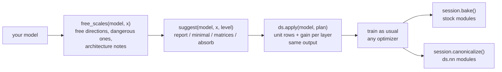

A patched layer computes with unit rows times a gain; the architecture notes are what a weight
patch cannot do, and belong in the model code. The `arch` models in [Measured](#measured) follow
them: every input enters through a norm without affine, the blocks write the residual stream with
unit rows and gains, and the output layer reads the stream directly with unit rows and no gain.
There is no final norm: a norm in front of the output hides the stream's scale from the loss and
makes it free. In JiT the conditioning and in-context tokens are attended to and never written,
so they keep the scale they entered with.

## Why scales drift

Give every parameter tensor $\theta_i$ a log-scale $s_i$ and look at the model as a function of
$\theta_i e^{s_i}$. A **free direction** is a vector $s$ along which the output does not change:

```math
f(\theta_1 e^{s_1}, \dots, \theta_n e^{s_n}) = f(\theta_1, \dots, \theta_n).
```

Examples: `up` $\times c$ with `down` $\times 1/c$; `q` $\times c$ with `k` $\times 1/c$; a norm's
gain $\times c$ with every layer that reads it $\times 1/c$; and any weight followed by a norm on
its own.

The loss is constant along a free direction, so its gradient has no component there. For a weight
$w$ whose scale is free, $\langle \nabla_w L, w\rangle = 0$, and one step $w' = w - \eta g$ gives

```math
\lVert w' \rVert^2 = \lVert w \rVert^2 + \eta^2 \lVert g \rVert^2 \ \ge\ \lVert w \rVert^2 .
```

The norm can only grow. With Adam every entry moves about $\eta$ per step whatever its gradient,
so a row of $n$ entries grows like a random walk, and a matrix row moves about $\sqrt{n}$ times
faster than a single gain. A free direction is **dangerous** when it moves activations and has a
matrix in it: that is where the drift is fast and the network sees it.

## What DragonScale changes

A patched layer uses unit rows times a gain in place of its weight:

```math
W_{\text{eff}} = \mathrm{diag}(g)\, r\, \frac{W}{\lVert W \rVert_{\text{row}}}
```

with $r$ the row radius (1 for linears and convs, $\sqrt{\text{dim}}$ for embeddings, so their rows
have unit RMS). The raw row length $\lVert W \rVert_{\text{row}}$ no longer reaches the output, so
the scale that drifted now lives in $g$: one number per row, moved by a gradient that is aligned
with the loss instead of by noise. The gradient reaching $W$ is tangent to its rows,

```math
\frac{\partial L}{\partial W} = \frac{g\, r}{\lVert W \rVert}\,\bigl(I - \hat w \hat w^\top\bigr)\, \frac{\partial L}{\partial W_{\text{eff}}},
```

so the raw rows still grow, slowly, and their growth shrinks the effective step of the direction:
a per-row $1/\sqrt{t}$ schedule.

## Analysis

`ds.analysis.free_scales(model, *inputs)` runs one forward pass, follows the scale of every
parameter through every op, and solves for the free directions. For a one-block pre-norm LM:

```text
7 free direction(s), 7 dangerous, 6 constraints over 13 groups
  dangerous: +1*embed.weight +1*pos.weight +1*blocks.0.out.weight +1*blocks.0.down.weight
  dangerous: +1*blocks.0.norm1.weight -2*blocks.0.k.weight -1*blocks.0.out.weight
  dangerous: +1*blocks.0.q.weight -1*blocks.0.k.weight
  dangerous: +1*blocks.0.v.weight -1*blocks.0.out.weight
  dangerous: +1*blocks.0.norm2.weight -1*blocks.0.gate.weight -1*blocks.0.down.weight
  dangerous: +1*blocks.0.up.weight -1*blocks.0.down.weight
  dangerous: +1*norm.weight -1*head.weight
architecture:
  attention calls [0]: q and k trade scale freely; normalize q and k (QK-norm) with a gain on one side only
  embed.weight, pos.weight, blocks.0.out.weight, blocks.0.down.weight scale the residual stream together; give the model input a fixed scale (an embedding: mode 'unit')
```

`gate` and `down` do not trade freely: SiLU pins the scale of `gate`.

`ds.analysis.suggest(model, *inputs, level=...)` turns the report into a plan:

| level | plan |
| --- | --- |
| `report` | nothing; read the report and its architecture notes |
| `minimal` | unit rows and a gain only on the layers in a dangerous direction |
| `matrices` | unit rows and a gain on every Linear / Conv / Embedding |
| `absorb` | each norm's affine is moved into the layers that read it and frozen; each layer whose row scale can move into the next layer (`v` into `out`, `up` into `down`) gets unit rows without a gain; the rest get unit rows and a gain |

Every level keeps the model's output. `absorb` plans carry the moves; run them before applying:

```python
plan = ds.analysis.suggest(model, x, level="absorb")
session = ds.apply(model, ds.analysis.absorb_plan(model, plan, x))
```

`ds.analysis.absorb(model, source, *inputs, into=None)` makes one move by hand; it finds the
consumers when `into` is None, refuses a move that is not free, and checks that the output did not
change. `ds.analysis.scale_jacobian` gives the spectrum of the same scale map numerically.

The architecture notes are what a weight patch cannot do; they belong in the model code.

## Patching options

Plans are data: `ds.make_plan(model, rules)` matches `ds.Rule(match, **options)` against module
paths or types, first match wins. `ds.apply` accepts a plan, a rule list or a preset name
(`unit_gain`, `unit`, `linear_unit_gain`, `conv_unit_gain`, `parametrize_unit_gain`).

| option | values | meaning |
| --- | --- | --- |
| `mode` | `unit_gain`, `unit`, `plain` | unit rows times a gain, unit rows alone, untouched |
| `gain` | `channel`, `scalar` | one gain per row, or one for the layer |
| `init` | `preserve`, `ones`, `reset`, `absorb` | gain = row length (same output), gain = 1, re-initialize then preserve, rows already moved by `absorb_plan` |
| `install` | `forward`, `parametrize`, `bake` | replace the module's forward, a torch parametrization, write the unit-row weight once |
| `method` | `normalize`, `rescale` | divide by the row length in every forward, or use the raw rows and let the optimizer rescale them after each step |

Supported layers: Linear, Conv1d/2d/3d, ConvTranspose1d/2d/3d, Embedding and transformers'
`Conv1D` (GPT-2); `ds.layer_types.register_layer_type` adds more. Tied weights (an LM head shared
with the embedding) are patched as one layer with one gain.

`ds.nn` has the same layers as modules (`UnitRowLinear`, `UnitRowConv2d`, `UnitRowEmbedding`, ...)
for new models, and `ds.functional.unit_rows(w, spec, gain)` does it for a bare weight.

## Optimizer

`method="normalize"` needs nothing from the optimizer. `method="rescale"` needs the gradient
decorator, which works with any torch optimizer through its step hooks:

```python
decorator = ds.optim.attach(optimizer, session)
```

Before each step it removes the part of each gradient that would change a row's length; after the
step it removes the same part from the momentum (Adam's `exp_avg`, SGD's and Muon's
`momentum_buffer`) and rescales each row back to its radius. Second moments are left alone.

## Checkpoints

| call | result |
| --- | --- |
| `session.state_dict("raw")` | raw weights and gains, under the module's own keys plus `<path>.gain` |
| `session.state_dict("baked")` | the unit-row weights under the stock keys; loads into the stock model |
| `session.bake()` | the model becomes stock modules with the unit-row weights, same output |
| `session.canonicalize()` | the patched modules become `ds.nn` modules in place (`native` state dict) |
| `session.remove()` | everything undone; the weights keep what training wrote |

`load_state_dict(state, format)` reads all three formats. Patched models work with
`copy.deepcopy`, `torch.save` of the whole model (`forward` install) and FSDP2.

`ds.monitor.Monitor(session)` reads each patched layer's output size, gains and raw row lengths
during training.

## Kernels and speed

The unit-row op is memory-bound: it reads a weight and writes one of the same size, so its speed
is its effective bandwidth, the bytes it must move over its time. The Triton kernels read a row
once when it fits 64 KB. On an 11008 x 4096 weight, forward + backward, they reach 85–96% of the
card's memory bandwidth, against 54–64% for `torch.compile` and 21–25% for eager. Every fp32
result matches fp64 to about 1e-7.

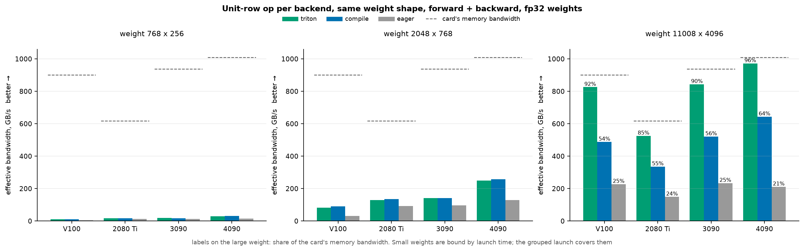

A unit-row Linear against a plain `nn.Linear`, forward + backward with the matmul, fp32 weights
under fp16 autocast: 96% of the plain layer's speed on a 4096 -> 11008 layer and 99% on 768 ->
2048, with Triton or `torch.compile`; eager reaches 87% and 96%.

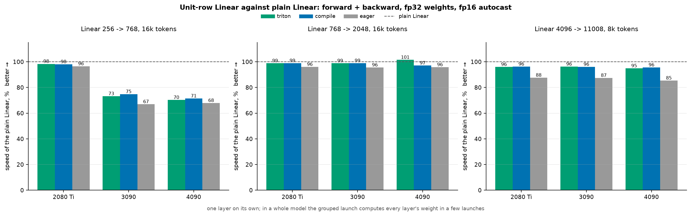

On a 256 -> 768 layer the unit-row launches are a visible share of a 1 ms step where the matmul
finishes faster than the host launches (73% on the 3090), and hidden where it does not (98% on
the 2080 Ti). Small layers are bound by launch time, about 0.06 ms per call on an RTX 4090. In eager mode a
forward pre-hook computes the weights of every eligible layer in one autograd node and a few
launches (`ds.apply(..., group=True)`, the default); under `torch.compile` the op is traced as
plain torch ops and fused. Whole training step of the byte-level LM (8 blocks, dim 256, batch
64 x 256, fp16 AMP) on an RTX 4090:

| preset | eager, per layer | eager, grouped | `torch.compile` |
| --- | --- | --- | --- |
| stock | 18.8 ms | 18.8 ms | 15.6 ms |
| matrices | 30.5 ms | 21.2 ms | 16.6 ms (+6%) |
| arch | 33.3 ms | 25.5 ms | 16.0 ms (+3%) |

`arch` in eager mode pays for its own extra norms and casts (830 kernel launches against 681);
compile fuses them. Peak memory under compile: 1.44 GB stock, 1.43 GB matrices, 1.55 GB arch.

| backend | used when | ops |
| --- | --- | --- |
| `triton` | CUDA, sm70 and up | every row op, grouped launch |
| `compile` | CUDA | `torch.compile` of the eager ops |
| `eager` | always | the reference, fp32 accumulation, fp64 kept |

`ds.apply(model, plan, backend=...)` pins one; by default the fastest available is used.
Benchmarks: `kogine run measure/ops/speed.py` (the op), `kogine run measure/ops/overhead.py`
(a layer against the plain layer).

## Measured

These runs check one thing: whether the scales stay put and the loss trains normally. They report
held-out loss and hidden-state statistics only. All runs are in [`measure/`](measure) and run
through [kogine](https://github.com/KohakuBlueleaf/KohakuEngine); every number comes from one
config file.

| preset | what it is |
| --- | --- |
| `stock` | the model as written |
| `matrices` | `suggest(level="matrices")` on the stock model |
| `arch` | `suggest(level="absorb")` plus the architecture notes done in the model code (see [How it works](#how-it-works)) |

A run **failed** when it diverged or its best held-out loss stayed above 2.0. `…`: still running.

### Byte-level LM

A pre-norm transformer (dim 256, 8 blocks, SwiGLU) on the bytes of the Python standard library,
AdamW, constant learning rate, no weight decay, 5k steps unless stated.

**A: learning rate x precision.**

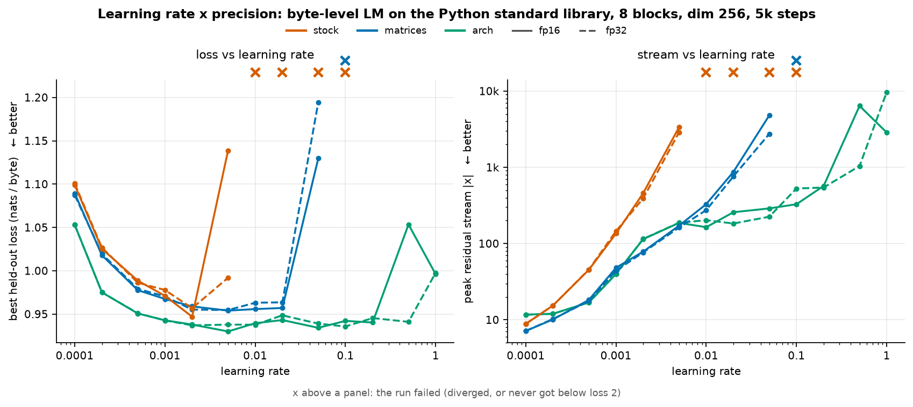

| preset | precision | best loss (lr) | largest lr that trains |
| --- | --- | --- | --- |
| stock | fp16 | 0.947 (2e-3) | 5e-3 |
| stock | fp32 | 0.957 (2e-3) | 5e-3 |
| matrices | fp16 | 0.954 (5e-3) | 5e-2 |
| matrices | fp32 | 0.955 (5e-3) | 5e-2 |
| arch | fp16 | 0.930 (5e-3) | 1.0 |
| arch | fp32 | 0.936 (0.1) … | 0.2 … |

fp32 fails where fp16 does: stock at lr 1e-2 and above ends near loss 2.4 with a stream of 1e6
to 1e12 in fp32, and diverges in fp16. The precision is not the cause.

**B: longer runs, 16k steps** at lr 2e-3 and 1e-2, fp16.

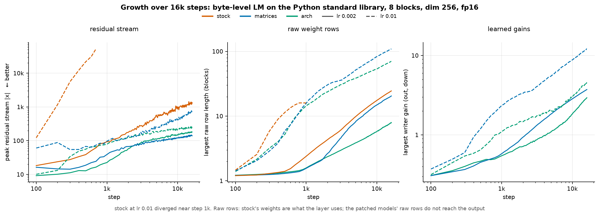

| preset | lr 2e-3: best loss, peak stream | lr 1e-2: best loss, peak stream |
| --- | --- | --- |
| stock | 0.957, 1,438 | failed at step 1k |
| matrices | 0.958, 147 | 0.962, 770 |
| arch | 0.939, 184 | 0.939, 263 |

The corpus is 10.7 MB; past a few thousand steps every preset memorizes it and the held-out loss
climbs back to 1.1–1.2.

**C and E: depth 4 / 8 / 16 / 32 and width 128 / 256 / 512 / 1024**, peak stream:

<p align="center">
  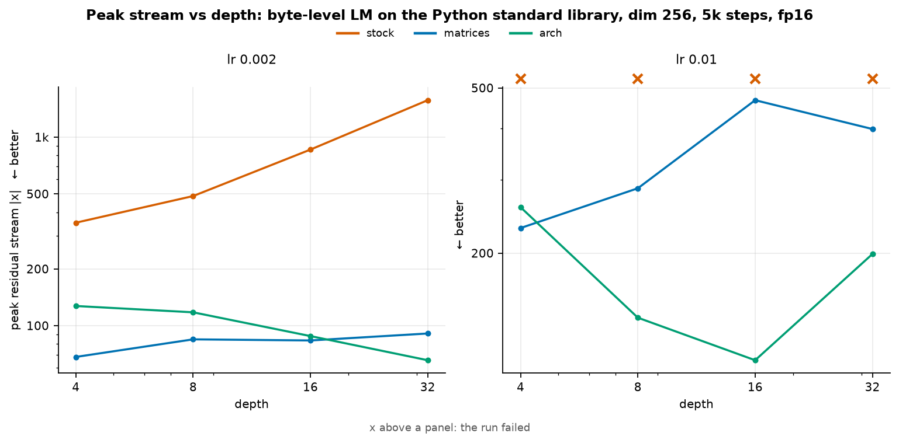
  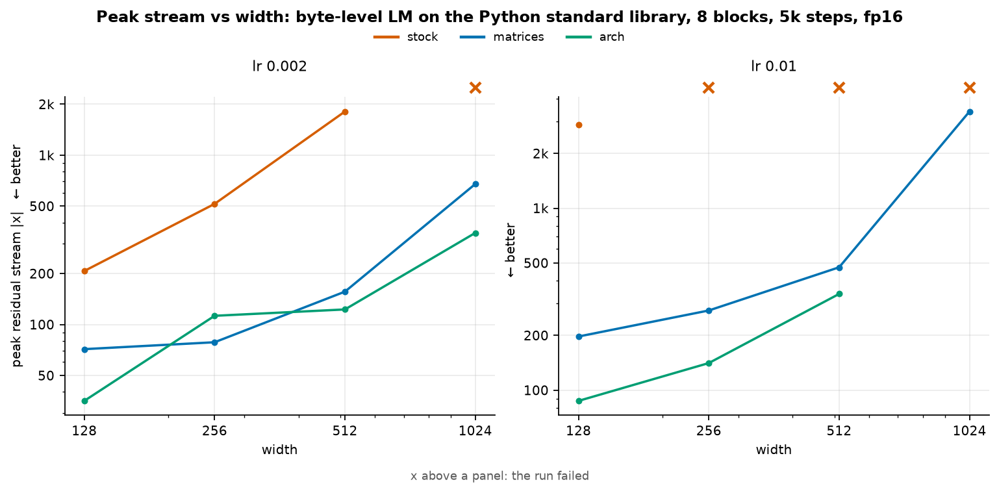
</p>

C, depth (best held-out loss):

| preset | lr | depth 4 | depth 8 | depth 16 | depth 32 |
| --- | --- | --- | --- | --- | --- |
| stock | 2e-3 | 0.995 | 0.956 | 0.941 | 0.936 |
| stock | 1e-2 | failed | failed | failed | failed |
| stock | 5e-2 | failed | failed | failed | failed |
| matrices | 2e-3 | 0.994 | 0.954 | 0.939 | 0.935 |
| matrices | 1e-2 | 1.006 | 0.960 | 0.939 | 0.932 |
| matrices | 5e-2 | 1.110 | 1.147 | 0.991 | failed |
| arch | 2e-3 | … | … | … | … |
| arch | 1e-2 | … | … | … | … |
| arch | 5e-2 | … | … | … | … |

**D: weight decay on stock** (best held-out loss, peak stream).

| weight decay | lr 1e-3 | lr 3e-3 | lr 1e-2 | lr 3e-2 | lr 0.1 |
| --- | --- | --- | --- | --- | --- |
| 0.01 | 0.975, 136 | 0.947, 791 | failed | failed | failed |
| 0.1 | 0.965, 52 | 0.942, 156 | 1.038, 6,790 | 1.299, 25,300 | failed |

Weight decay 0.1 keeps stock training at lr 1e-2 and 3e-2, with the stream still at 7k–25k.

E, width (best held-out loss):

| preset | lr | width 128 | width 256 | width 512 | width 1024 |
| --- | --- | --- | --- | --- | --- |
| stock | 2e-3 | 0.990 | 0.955 | 0.948 | failed |
| stock | 1e-2 | 1.035 | failed | failed | failed |
| stock | 5e-2 | failed | failed | failed | failed |
| matrices | 2e-3 | 0.987 | 0.958 | 0.940 | 0.982 |
| matrices | 1e-2 | 0.977 | 0.967 | 1.121 | 1.187 |
| matrices | 5e-2 | 0.970 | 1.047 | failed | failed |
| arch | 2e-3 | 0.970 | 0.938 | 0.932 | 0.953 |
| arch | 1e-2 | 0.951 | 0.942 | 0.940 | … |
| arch | 5e-2 | 0.952 | 0.942 | 0.935 | … |

Stock's stream grows with width (207, 516, 1,812 at lr 2e-3) and width 1024 diverges at the
smallest learning rate.

**Loss against stream size**, every run of A–E: the frontier per preset (left) and each setup's
learning-rate sweep as one line (right).

<p align="center">
  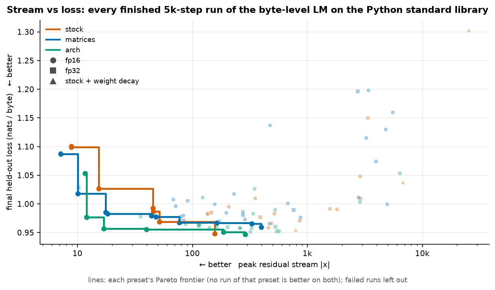
  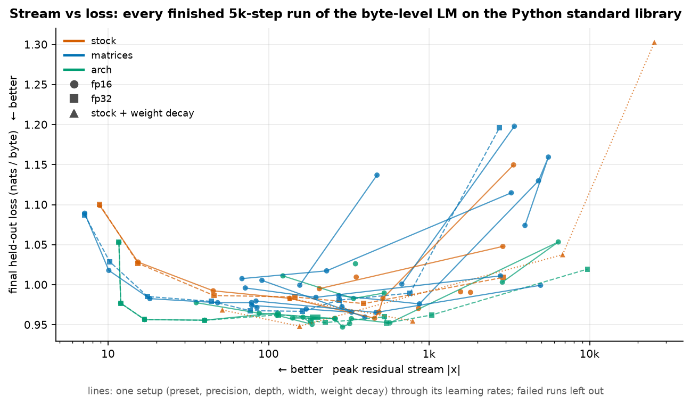
</p>

### JiT-B/16 on Flowers-102

Pixel-space diffusion with the JiT recipe (x-prediction, velocity loss) at 256 px, batch 64, the
time and class as conditioning tokens, fp16.

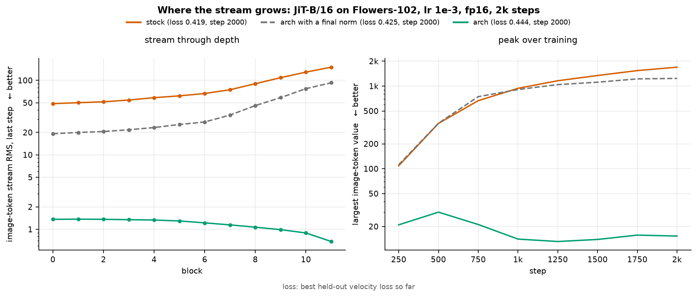

| model, lr 1e-3, 2k steps | stream RMS, block 0 -> 11 | peak | held-out loss |
| --- | --- | --- | --- |
| stock | 49 -> 150 | 1,694 | 0.419 |
| arch with a final norm | 19 -> 93 | 1,239 | 0.425 |
| arch | 1.4 -> 0.8 | 15 | 0.444 |

A final norm in front of the output makes the stream's scale free, and it grows in the patched
model as in stock. Without it, and with the context tokens read-only, the stream stays near 1.

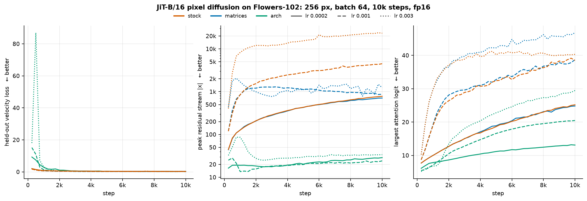

| preset | lr | held-out loss, 10k steps | peak stream |
| --- | --- | --- | --- |
| stock | 2e-4 | 0.264 | 779 |
| stock | 1e-3 | 0.219 | 4,506 |
| stock | 3e-3 | 0.247 | 23,804 |
| matrices | 2e-4 | 0.260 | 710 |
| matrices | 1e-3 | 0.216 | 1,294 |
| matrices | 3e-3 | 0.217 | 2,055 |
| arch | 2e-4 / 1e-3 / 3e-3 | … | … |

Reproduce, for example:

```bash
kogine run measure/bytelm/train.py --set BUILD_CORPUS=true
kogine workflow parallel measure/bytelm/train.py --config measure/bytelm/configs/a_stock.py --workers 2
kogine run measure/plots.py
```

## Repository

| path | contents |
| --- | --- |
| `src/dragonscale/` | the library: analysis, plans, patching, the grouped launch, the gradient decorator, unit-row modules |
| `src/dragonscale_kernels/` | the row ops per backend: eager reference, `torch.compile`, Triton |
| `src/dragonscale_common/` | helpers shared by both, without torch: logger, name registry, dotted-path import, problem lists |
| `measure/` | experiments, op benchmarks and figures, one folder each, run with kogine |
| `tests/` | patch / remove / bake / canonicalize, the grouped launch, and the analysis on hand-checked models |

## License

Apache-2.0.
