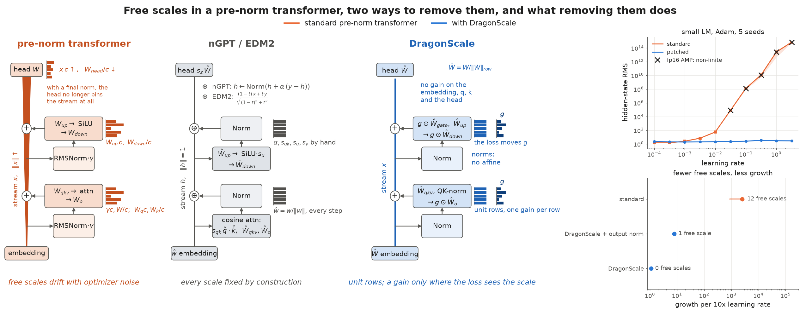
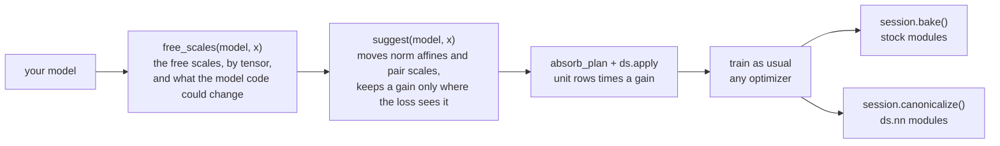
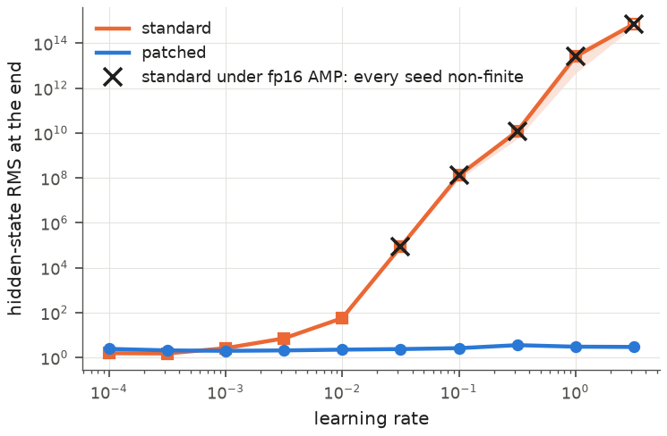
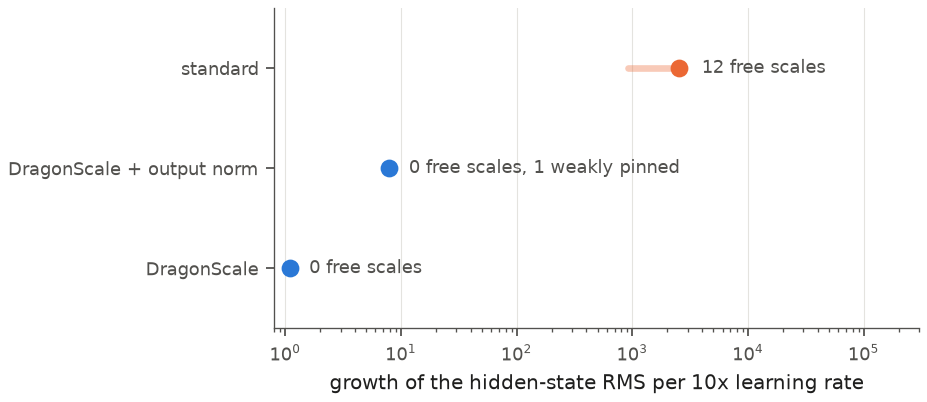
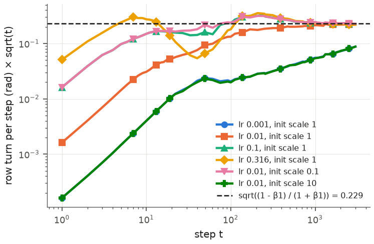
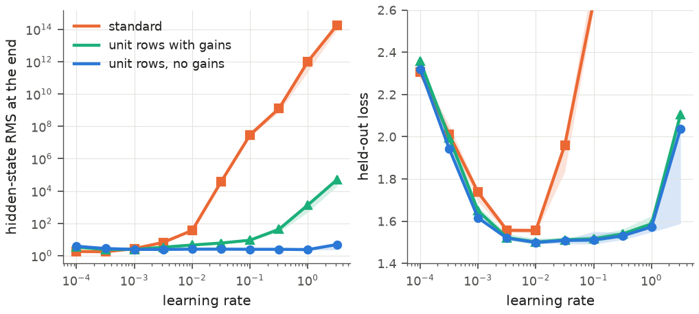
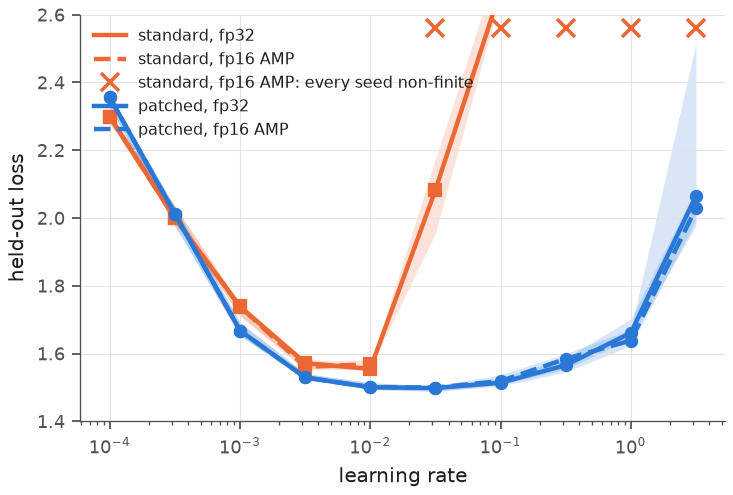
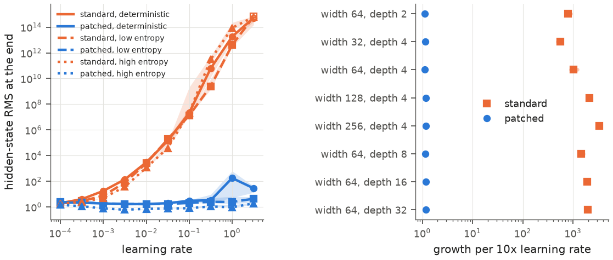
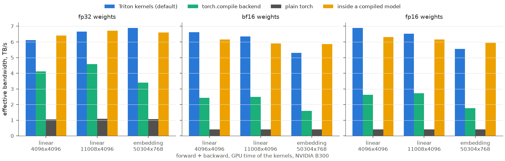
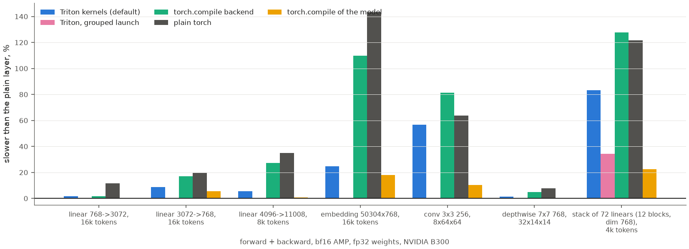

# DragonScale

<picture><source media="(prefers-color-scheme: dark)" srcset="docs/figures/teaser_dark.png"></picture>

Some scales in a network can change without changing what the loss sees. In a transformer MLP
you can multiply `up` by 2 and divide `down` by 2 and get the same output. The loss gives no
gradient along such a direction, but every optimizer step still moves the weights a little along
it, and those moves add up. The residual stream of a pre-norm transformer is the largest case: it
can grow while the output layer shrinks to match. We call such a direction a **free scale**.

DragonScale finds the free scales of a PyTorch model by tracing one forward pass. It then rewrites
the weights as rows of fixed length, with a learned gain per row only where the loss sees the
scale. After the patch, no free scale changes a hidden state.

**Contents:** [Highlights](#highlights) · [Install](#install) · [Quick start](#quick-start) ·
[How it works](#how-it-works) · [Why scales drift](#why-scales-drift) ·
[What DragonScale changes](#what-dragonscale-changes) ·
[Results on small models](#results-on-small-models) · [Kernels and speed](#kernels-and-speed) ·
[Training notes](#training-notes) · [Supported layers and limits](#supported-layers-and-limits) ·
[Checkpoints](#checkpoints) · [Repository](#repository)

## Highlights

- **Finds every free scale in one forward pass** and names the tensors in each one, split into
  those that change a hidden state and those that do not.
- **Leaves no free scale that changes a hidden state.** The tests check this on small versions of
  a language model, a diffusion transformer, a ViT student and a ConvNeXt student.
- **Keeps the hidden state in place.** On a small language model with Adam, the standard model's
  hidden state grows about 2,500x for every 10x in learning rate; the patched model's grows 1.1x.
- **Hand-written Triton kernels by default.** On an NVIDIA B300 the unit-row op is 1.3x to 11x
  faster than its `torch.compile` version (GPU time, 8 weight shapes, 3 dtypes). With
  `torch.compile` of the whole model, a patched layer's training step takes 100% to 124% of the
  plain layer's.
- **fp16 AMP and bf16 AMP.** Row lengths are summed in fp32, and every backend matches an fp64
  reference to the rounding of the weight's own dtype.

## Install

```bash
pip install "dragonscale[triton]"    # GPU, with the Triton kernels
pip install dragonscale              # CPU only
```

From source: `pip install -e ".[triton]"`. Needs Python 3.11+ and PyTorch 2.9+.

## Quick start

```python
import torch
from torch import nn

import dragonscale as ds

torch.manual_seed(0)
model = nn.Sequential(  # a small pre-norm transformer: embedding, one block, output layer
    nn.Embedding(256, 64),
    nn.TransformerEncoderLayer(64, nhead=4, dropout=0.0, batch_first=True, norm_first=True),
    nn.Linear(64, 256),
)
tokens = torch.randint(0, 256, (8, 33))
x, y = tokens[:, :-1], tokens[:, 1:]

# Which scales can move without the loss seeing them?
print(ds.analysis.free_scales(model, x).describe())

# Unit rows everywhere, a gain only where the loss sees the scale.
plan = ds.analysis.suggest(model, x)
session = ds.apply(model, ds.analysis.absorb_plan(model, plan, x))

# Gains are ordinary parameters; weight decay goes on the raw weights only.
optimizer = torch.optim.AdamW(ds.optim.param_groups(session, weight_decay=0.1), lr=1e-3)
for step in range(10):
    loss = nn.functional.cross_entropy(model(x).flatten(0, 1), y.flatten())
    optimizer.zero_grad()
    loss.backward()
    optimizer.step()

session.bake()  # back to stock modules with the trained weights, same output
```

The report for this model, in part:

```text
4 free scale(s): 4 change a hidden state, 0 change none; 0 weakly pinned; 0 op call(s) without a rule
  +1 0.weight +1 1.self_attn.out_proj.weight +1 1.self_attn.out_proj.bias +1 1.linear2.weight +1 1.linear2.bias -1 2.weight
  +1 1.linear1.weight -1 1.norm2.weight -1 1.norm2.bias
```

Each line is one free scale: scale each tensor on it by `c` to the power shown, and the output
stays the same. The first line is the residual stream. The embedding and both layers that write
into the stream grow together, and the output layer shrinks to match. The second is a norm's
affine trading scale with the layer that reads it. [docs/analysis.md](docs/analysis.md) explains
the rest of the report.

## How it works



A patch can only change weights. Some free scales come from the model code itself, for example a
norm in front of the output layer. The report names those, and fixing them is up to you (see
[the model-side rules](#model-side-rules)).

## Why scales drift

Give every parameter tensor $\theta_i$ a log-scale $s_i$. A **free scale** is a vector $s$ that
leaves the output unchanged:

```math
f(\theta_1 e^{s_1}, \dots, \theta_n e^{s_n}) = f(\theta_1, \dots, \theta_n).
```

Examples: `up` $\times c$ with `down` $\times 1/c$; `q` $\times c$ with `k` $\times 1/c$; a norm's
gain $\times c$ with every layer that reads it $\times 1/c$.

The loss is constant along a free scale, so its gradient has no component there. For a weight $w$
whose scale is free on its own, $\langle \nabla_w L, w\rangle = 0$, and one gradient step
$w' = w - \eta g$ gives

```math
\lVert w' \rVert^2 = \lVert w \rVert^2 + \eta^2 \lVert g \rVert^2 \ \ge\ \lVert w \rVert^2 .
```

The norm can only grow. With Adam every entry moves by about $\eta$ per step whatever its
gradient, so a row of $n$ entries drifts like a random walk, about $\sqrt{n}$ times faster than a
single gain. Weight decay pulls the other way. The norm then settles where the two balance, at a
size set by the learning rate and the decay, not by the loss.

## What DragonScale changes

A patched layer computes with unit rows in place of its weight:

```math
W_{\text{eff}} = \mathrm{diag}(g)\; r\; \frac{W}{\lVert W \rVert_{\text{row}}}
```

Here $r$ is a fixed row length: 1 for linears and convs, $\sqrt{\text{dim}}$ for embeddings. The
raw row length no longer reaches the output, so its drift does nothing. The scale lives in the
gain $g$, one number per row, which the loss does see. Without weight decay the raw rows still
grow slowly, and each step turns them a little less: under Adam the turn per step falls as
$1/\sqrt{t}$ (figure C below).

Where the gains go is the one choice left:

| `suggest(..., gains=)` | gain on | free scales left that change a hidden state | output at the start |
| --- | --- | --- | --- |
| `"all"` (same as `level="absorb"`) | every patched layer | the stream, through the gains | unchanged |
| `"selective"` (default) | only where the loss sees the scale | none | changes in the layers that lose their gain |
| `"none"` | the output layer only, with `output_gain` | none | changes in every layer |

With the default, the embedding, the output layer, and q and k behind a QK-norm lose their gain.
Their rows restart at length $r$, so the output at the start changes. In the quick start it
changes by up to 1.9, against an output RMS of 0.61, and `ds.apply` logs the two layers. That is
fine for training from scratch. **For a pretrained model**, use `level="absorb"`, which keeps the
output unchanged, or plan to re-train.

### Model-side rules

The patch removes every free scale it can reach through weights. The rest needs changes in the
model code, and the report's notes say which apply:

- norms without an affine, or with the affine moved into the next layer (`absorb_plan` does this);
- every input enters at a fixed scale: an embedding with unit rows, or a norm after a patch
  embedding;
- the output layer reads the residual stream directly; a norm in front of it leaves the stream's
  scale weakly pinned;
- q and k normalized, with a gain on one side only (`ds.nn.QKNorm`);
- LayerScale folded into the gain before it (`ds.fold_layerscale`).

The patch does not fix every scale. It works per tensor, so it says nothing about how scale is
spread across the rows or channels of one weight.

## Results on small models

All figures: a small transformer language model (2 blocks, width 64, byte vocabulary), Adam,
3,000 steps. Lines are medians over seeds; bands run from the lowest to the highest seed. Data and
scripts: [docs/figures](docs/figures).

<!-- Figure candidates (owner to choose): delete a candidate's block to drop it. -->

<!-- candidate A -->
<picture><source media="(prefers-color-scheme: dark)" srcset="docs/figures/a_stream_dark.png"></picture>

**A.** 5 seeds. The standard model's hidden state grows by about 2,500x per 10x learning rate.
The patched model's stays between 2 and 3.6 up to learning rate 3.2. Crosses: every fp16 AMP run
of the standard model went non-finite there.
<!-- end A -->

<!-- candidate B -->
<picture><source media="(prefers-color-scheme: dark)" srcset="docs/figures/b_ladder_dark.png"></picture>

**B.** 5 seeds, five versions of the same model. Growth falls as the free scales that change a
hidden state are removed, down to 1.1x at zero. Keeping the norm in front of the output layer
leaves one weakly pinned scale and 7.8x.
<!-- end B -->

<!-- candidate C -->
<picture><source media="(prefers-color-scheme: dark)" srcset="docs/figures/c_angle_dark.png"></picture>

**C.** 5 seeds, patched model, AdamW without weight decay. Once its steps are large enough, a unit
row turns by sqrt((1 - β1) / (1 + β1)) / sqrt(t) per step, whatever the learning rate and the
initial scale.
<!-- end C -->

<!-- candidate D -->
<picture><source media="(prefers-color-scheme: dark)" srcset="docs/figures/d_cosine_dark.png"></picture>

**D.** 5 seeds, with a cosine (scale-invariant) output. Here a gain the loss cannot see is itself
a free scale: with gains the hidden state still grows, without them it does not, at the same loss.
<!-- end D -->

<!-- candidate E -->
<picture><source media="(prefers-color-scheme: dark)" srcset="docs/figures/e_fp16_amp_dark.png"></picture>

**E.** 5 seeds, fp32 and fp16 AMP. From learning rate 0.03, every fp16 AMP run of the standard
model goes non-finite. The patched model's fp16 AMP runs follow its fp32 runs.
<!-- end E -->

<!-- candidate F -->
<picture><source media="(prefers-color-scheme: dark)" srcset="docs/figures/f_data_and_shape_dark.png"></picture>

**F.** Left: three Markov data sources of different entropy, 5 seeds. Right: eight widths and
depths, 3 seeds. The standard model's hidden state grows by 550x to 3,300x per 10x learning rate,
the patched model's by 1.1x to 1.2x.
<!-- end F -->

<!-- End of figure candidates. -->

## Kernels and speed

The unit-row op reads a weight and writes one of the same size, so its speed is set by memory
bandwidth. On CUDA it runs on hand-written Triton kernels. Without Triton it falls back to the
`torch.compile` version of the op, then to plain torch, and logs one line naming the backend at
first use. `ds.apply(..., backend=...)` pins one. Under `torch.compile` of the whole model the
op is traced as plain torch ops and fused with the rest.

<picture><source media="(prefers-color-scheme: dark)" srcset="docs/figures/kernels_dark.png"></picture>

On large weights the Triton kernels move 5.4 to 6.9 TB/s on an NVIDIA B300, the same as the op
fused inside a compiled model, and 1.4x to 3.3x the `torch.compile` backend's rate.

<picture><source media="(prefers-color-scheme: dark)" srcset="docs/figures/layer_speed_dark.png"></picture>

A whole training step of one layer, bf16 AMP. A large matmul hides most of the op (102% and 106%
with the kernels for 768->3072 and 4096->11008). Small, fast layers do not: in eager mode a 3x3 conv takes 180%, and a stack of 72
small linears 209%, or 134% with the grouped launch, which computes every weight in a few
launches (`group=True`, the default). With `torch.compile` of the model the step takes 100% to
124% of the plain one.

The kernels are as accurate as plain torch. Row lengths are summed in fp32 for every weight
dtype, so under fp16 AMP and bf16 AMP the norm is computed in fp32. Worst error against an fp64
reference, over the output and both gradients of seven weight shapes, relative to each row's
largest entry:

| weight dtype | Triton kernels | `torch.compile` | plain torch (fp32 sums) | plain torch at the weight's dtype |
| --- | --- | --- | --- | --- |
| fp32 (the master weights under AMP) | 2.6e-7 | 2.7e-7 | 2.5e-7 | 2.4e-7 |
| bf16 | 3.9e-3 | 3.9e-3 | 3.9e-3 | 1.3e-2 |
| fp16 | 4.9e-4 | 4.9e-4 | 4.9e-4 | 1.7e-3 |

Backends, benchmark scripts and where the per-shape numbers are: [docs/kernels.md](docs/kernels.md).

## Training notes

- **Weight decay.** `ds.optim.param_groups(session, weight_decay)` decays the raw weights of
  patched layers and other matrices, and leaves gains, biases and norm affines alone. Decay on a
  raw weight does not change the output. It shrinks the raw rows, so later steps turn them
  further.
- **Warmup.** The first steps turn a unit row the most (figure C). A short learning-rate warmup
  limits them.
- **fp16 AMP and bf16 AMP.** Keep the master weights in fp32 as usual. fp16 AMP needs its
  gradient scaler, as for any model.
- **EMA and eval.** In eval mode every forward recomputes the unit rows, so an EMA update or a
  `load_state_dict` shows up at once. Inside `with session.cache_weights():` they are computed
  once; call `session.invalidate()` after changing weights there.
- **Rows that never update.** An embedding row whose token never appears keeps its first value.
  Row lengths are floored at 1e-12, so a zero row stays zero and finite on every backend.

## Supported layers and limits

- Patched: `Linear`, `Conv1d/2d/3d`, `ConvTranspose1d/2d/3d`, `Embedding`, `MultiheadAttention`,
  the layers inside `TransformerEncoderLayer`, and transformers' `Conv1D`.
  `ds.layer_types.register_layer_type` adds more. Tied weights share one gain.
- Tested with `torch.compile`, `DistributedDataParallel`, FSDP2 (`fully_shard`), `copy.deepcopy`
  and `torch.save` of the whole model.
- The analysis traces one forward pass, so control flow that depends on the data is seen only as
  it ran on the example input. An op without a rule is reported, never guessed, and `suggest`
  stops unless you pass `allow_unknown=True`.

## Checkpoints

| call | result |
| --- | --- |
| `session.state_dict("raw")` | raw weights and gains |
| `session.state_dict("baked")` | the unit-row weights under the stock keys; loads into the stock model |
| `session.bake()` | stock modules with the unit-row weights, same output |
| `session.canonicalize()` | the patched modules become `ds.nn` modules |
| `session.remove()` | the patch undone; the weights keep what training wrote |

Patch options, presets, the `ds.nn` modules and the monitor: [docs/patching.md](docs/patching.md).

## Repository

| path | contents |
| --- | --- |
| `src/dragonscale/` | the library: analysis, plans, patching, kernels, `ds.nn` modules |
| `tests/` | the test suite, including the README and docs code blocks |
| `measure/ops/` | speed, precision and overhead benchmarks of the unit-row op |
| `docs/` | analysis and patching notes, kernel tables, figures and their data |

## Citation

To be added.

## Licence

Apache-2.0.
